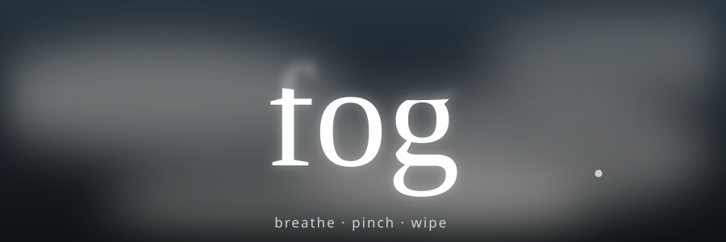

<p align="center"></p>

# fog

A bathroom mirror that has fogged up, made from your webcam. Breathe on your laptop and fog blooms. Pinch to write in it. Make a fist and swipe to wipe it clear.

**Try it:** https://shrutip04.github.io/fog/

<!-- Add a screenshot or GIF here:  -->

## Controls

| Action | What it does |
| --- | --- |
| Breathe at the laptop | Fog blooms near your mouth. An open-mouth "ha" blooms stronger |
| Pinch thumb and index finger | Draws in the fog, with a glowing star on your fingertip |
| Fist and swipe | Wipes a wide area clear, like a sleeve |
| `Space` (hold) | Fogs without breathing, for silent demos |
| `C` | Clears your drawing and resets the fog |
| `S` or the shutter button | Saves a PNG |
| `R` or the record button | Records a 10-second clip as `fog.webm` |
| `M` or the note button | Mutes the sound effects |
| `Esc` | Back to the start screen |
| Brush slider (bottom left) | Sets the erase radius |

Letters you draw slowly sag and drip, as on a steamy mirror.

## Privacy

Everything runs in your browser. No video, audio or data is sent anywhere. The only network requests are for the hand and face tracking models and scripts, which load from the jsDelivr CDN.

## Run it locally

The camera only works on `https` or `localhost`, so double-clicking the file will not work. From the project folder:

```
python -m http.server 8000
```

Then open http://localhost:8000/

## Notes

- Works best in Chrome or Firefox. Safari cannot record WebM clips.
- Use headphones with sound on, or the mic can hear the sound effects and fog the screen by itself.
- Single file, no build step, no framework. Uses [MediaPipe](https://developers.google.com/mediapipe) Hands and Face Mesh.
- Breath detection floats on the room's noise floor, so it adapts to each room. If it fogs too easily or not enough, tune the thresholds near the `lvl - floor` line in `loop()`.

## How it works

Three stacked canvases: the mirrored camera, a hidden fog canvas that stores how much fog is at each pixel, and a blurred, tinted copy of the camera masked by that fog. Erasing subtracts from the fog canvas with `destination-out`, so the sharp camera shows through.
